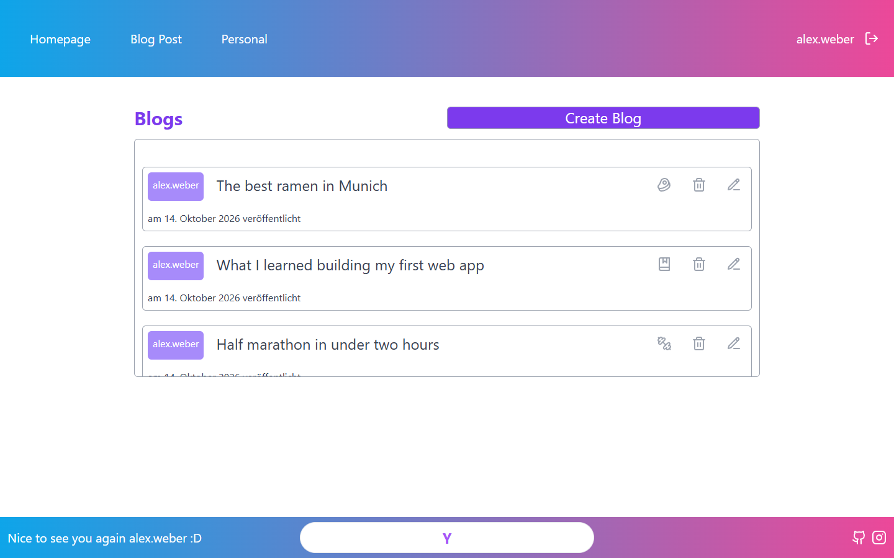
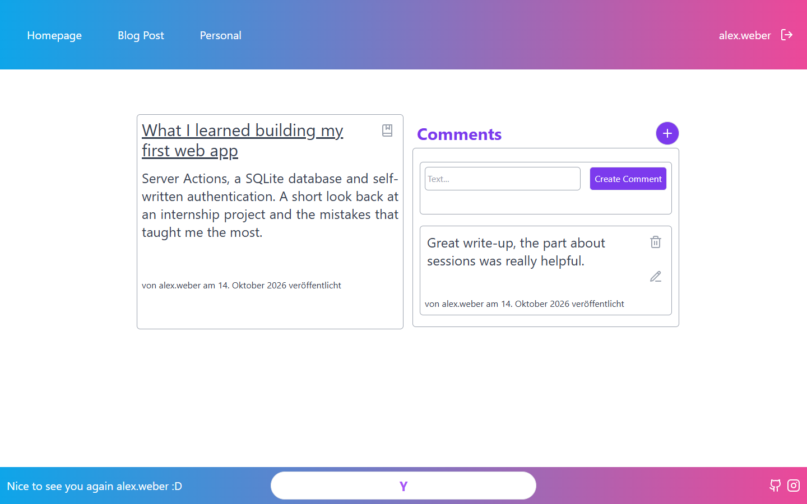

# BlogPost

[](https://github.com/Tristan-sketch/BlogPost/actions/workflows/ci.yml)


[](LICENSE)

A blog platform built during my internship at Titanom Technologies. Users can create an account, write blog posts, filter them by theme, and comment on posts. They can edit and delete their own posts and comments.

The app runs completely on its own: no external services, no API keys, no database server.

| Blog overview | Post with comments |
|---|---|
|  |  |

## Features

- Sign up, sign in and sign out with self-written, session-based authentication
- Create, edit and delete posts; every post has a theme with its own icon
- Comment on posts; edit and delete your own comments
- Personal page with your own posts
- Authorisation checked on the server for every change, not just hidden in the UI

## Tech stack

- [Next.js 14](https://nextjs.org/) (App Router, Server Actions) with TypeScript
- [Tailwind CSS](https://tailwindcss.com/)
- SQLite via Node's built-in [`node:sqlite`](https://nodejs.org/api/sqlite.html) module
- Self-written authentication: passwords hashed with scrypt, sessions in an HTTP-only cookie

## Requirements

- Node.js **22.13 or newer** (for `node:sqlite`)
- [pnpm](https://pnpm.io/)

## Getting started

```bash
pnpm install
pnpm dev
```

Open [http://localhost:3000](http://localhost:3000) and create an account under **Sign up**.

The database is created automatically on first start at `data/blog.db`. To use a different location, set the `DATABASE_PATH` environment variable. To reset all data, delete the `data` folder.

## Scripts

| Script       | Description                  |
| ------------ | ---------------------------- |
| `pnpm dev`   | Start the development server |
| `pnpm build` | Build for production         |
| `pnpm start` | Start the production server  |
| `pnpm lint`  | Run ESLint                   |

## Project structure

```
src/
├── app/
│   ├── actions/    # Server Actions (auth, blogs, comments)
│   ├── blog/       # Blog overview, detail page, create/edit, comments
│   ├── login/      # Sign-in page
│   ├── register/   # Sign-up page
│   └── personal/   # Account page with the user's own posts
├── db/
│   ├── index.ts    # SQLite connection and schema
│   └── queries.ts  # Read queries
├── lib/
│   ├── auth.ts     # Password hashing and sessions
│   └── themes.tsx  # Blog themes and their icons
└── middleware.ts   # Redirects visitors without a session to /login
```

## How authentication works

- On sign-up the password is hashed with `scrypt` and a random salt. The plain password is never stored.
- On sign-in a random session token is stored in an HTTP-only cookie. The database only keeps a SHA-256 hash of that token.
- Sessions expire after 30 days. Signing out deletes the session.
- Every action that changes data checks on the server that the user is signed in and owns the post or comment.

## License

Released under the [MIT License](LICENSE).
